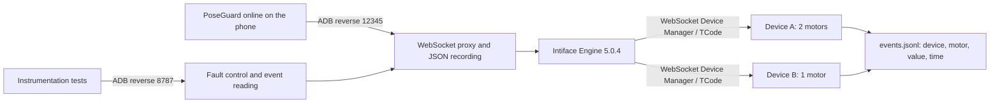

# Automated PoseGuard checks on a physical device

The checks are split by what they measure: session logic, the link to a real Intiface server, camera and MediaPipe, and the Android codec. In every scenario the result is decided by test assertions, not by watching the screen.

## Commands

```bash
source ./env.sh
pg quick-test offline
pg quick-test online
pg intiface-test
pg restart-test
pg camera-smoke offline
pg camera-smoke online
pg ui-test offline
pg release-check
```

The same suites run on the minified release build (`pg release-test`, `pg release-audit`, `pg release-check`); see "Release configuration and R8".

The commands build the required debug/test APKs, install them with `adb install -r` and run `adb shell am instrument`. The `--no-build` flag skips the build, for example `pg quick-test online --no-build`; use it only when the APK already matches the sources. `ANDROID_SERIAL` selects the phone. Reports, the crash buffer and Intiface commands are written to a separate `artifacts/device-*` folder for each run.

For a short check of a specific behavior, classes or single methods are available:

```bash
pg scenario offline 'SessionScenarioTest#slowDisplacementIsClassifiedAsDriftAndEmitsDriftCue' --no-build
pg scenario offline MediaScenarioTest --no-build
pg scenario online 'IntifaceSessionScenarioTest#pauseViolationZerosBackgroundAndThenRestoresIt' --no-build
pg scenario online 'IntifaceControllerScenarioTest#switchingStopsPreviousDeviceBeforeSignallingNewDevice' --no-build
```

An online scenario gets the bench and ADB reverse automatically; the extra restart check is not included in a single-scenario run. After changing code, run the command without `--no-build`.

Instrumentation tests use the package `com.incident201.poseguard`; online and offline are installed in turn over the same app. `flock` prevents concurrent runs on one phone. The script keeps app data on install, and the scenarios save and restore the app settings. The camera check grants CAMERA, and the Intiface checks on Android 17 grant ACCESS_LOCAL_NETWORK. These permissions stay granted after the test. Android checks whether the already installed APK is compatible with the debug signature; the script does not uninstall an incompatible app.

## Fast session scenarios

`SessionScenarioTest` runs the real `GameViewModel` on Android. It receives synthetic Bitmaps and 33 landmarks through `registerCameraFrame()` and `processMediaPipeResults()`, so timestamp matching, identity stabilization, smoothing, the tracker, penalties, states, audio events and the session result all run. The test never writes `HoldingPose` or `Success` directly.

The internal `SessionTiming` lets the test feed monotonic time and skip the stabilization/countdown waits. The app's public constructor keeps the original behavior: system time, 4 seconds of stabilization and a 10-second countdown. Intiface delays stay real, to check pulse cancellation and late commands.

| Scenario | Checked result |
| --- | --- |
| Holding a stable pose | Success, correct summary, no violations, start and finish audio events |
| Brief MediaPipe dropout | Recovery without a violation or penalty |
| Long disappearance | PersonDisappeared violation, Failed at the limit |
| Pose movement | Full pipeline; slow displacement is classified as Drift, fast movement as Motion; matching audio events |
| Penalty and cooldown | The timer increases; a repeated violation during cooldown is not counted |
| Penalties disabled | Violations are counted without adding time |
| Stop and new session | Old violations and summary are reset; the new session can finish |
| Camera stopped delivering frames | Failed instead of a false Success at the deadline |
| App goes to background | Waiting to start is cancelled; an active session ends |
| No reference pose | Holding does not start |
| Random timer | The chosen duration is used and a correct summary is produced |
| FaceToCamera / FaceAwayFromCamera | On frames without a face, the first mode rejects the session and the second allows holding |
| Face Detector cannot get a crop | After a timeout the session ends as a technical error, without a penalty or a blaming audio phrase |
| Tiered penalties | The first, second, third and later violations add the configured time; a violation at the limit ends the session without a penalty |
| Phone stabilization | A moving phone stays in waiting; stillness for the whole period starts the countdown; movement restarts the period; Stop cancels waiting |
| Preparation countdown | The countdown runs in real time with audio cues; Stop during the countdown leaves no late transitions; a stale frame at the end of the countdown gives Failed |

Face checks use the real native Face Detector on a synthetic blank image. They do not measure how accurately a human face is detected.

`SettingsScenarioTest` checks on real SharedPreferences that settings of every type (enum by name, numbers, strings, TTS phrases, PCM, Intiface parameters, timer) survive a process restart, and that changing the language changes status texts for all six languages. In release it also checks that R8 has not broken the enums and data classes read through `valueOf`.

`AppFlowScenarioTest` (LargeTest, `pg ui-test`) walks the user path in the real `MainActivity` using only what is visible on screen, without touching internal classes: first launch with language selection and onboarding up to the main screen, no onboarding after Activity recreation, Start → Stop returns the main screen to Idle, changing a setting on the settings screen and navigating back.

`MediaScenarioTest` encodes synthetic images to MP4 through the real MediaCodec/MediaMuxer and checks the AVC track, dimensions, multiple samples, monotonic PTS and the 10x time speed-up. MediaMetadataRetriever decodes the video; the frame color confirms that the supplied image was recorded. It also checks repeated recording, empty recording, discard, release, that no files are left behind, and that frames after release are ignored. Temporary videos are deleted.

## Intiface bench



The server uses the official WebSocket Device Manager and the real Buttplug v3 protocol used by the current Java client. The device accepts TCode commands such as `V060` and `V160`; the checks confirm the command at the server's output, not just the UI status or the sent request. Bluetooth, serial, real motors and the Intiface GUI are not used on the bench.

`IntifaceControllerScenarioTest` checks:

- Discovery of two devices, different motor counts, strength clamped to 0–1, test pulses and stopping.
- Manual disconnect with zeroing, a new search and reconnection.
- Switching: A is stopped before B is signalled; positive commands after switching go only to B.
- Saved device identity when the server index is stale; a missing saved device is not replaced with another one.
- Physically disconnecting the virtual device from the Engine, clearing the selected device and rediscovery after reconnection.
- Empty search, invalid URL, timeout, server Error and recovery after a transport break.
- A test pulse waits for an unfinished stop command, and repeated test requests do not pile up in the queue.

The new tests reproduced and helped fix an app bug: the previous device kept a non-zero output after switching. Selection now runs under the same mutex as vibration commands, after the previous device has confirmed it stopped. If stopping fails, the new device is not selected and the error goes into the controller state. The ViewModel saves only the device that was actually selected; consecutive selection requests are serialized. A skipped test pulse while the stop command's mutex was held is also fixed: a separate mutex limits repeated tests, and the pulse itself waits for the command queue to free up.

`IntifaceSessionScenarioTest` checks the link to the session lifecycle:

- Background signal 20% → violation 70% → back to 20% → stop 0%.
- Success stops background signals.
- Camera loss stops signals without adding a violation.
- After a stop, late callbacks do not restart vibration.
- Switching during an active session moves background and violation signals to B, zeroing A.
- Disabling Intiface mid-effect cancels late signals while the game session continues.
- Pause mode: zero output, then the background is restored; Pulse mode: several on/off cycles.
- A terminal violation plays the configured effect and does not restore the background.
- Movement and face-rule violations trigger the configured signal.
- A Face Detector technical error stops the background without a penalty or a punishing signal.

`IntifaceRestartScenarioTest` runs as separate instrumentation calls. The first saves selection B through the real ViewModel and UI; the script runs `adb shell am force-stop` and checks that the process is gone; the second opens the real MainActivity in a new process. The normal CameraScreen logic restores B automatically, the session stays Idle, and there are no positive signals until an explicit test pulse. The original settings are saved in a private file and restored by a third call, including on failure through cleanup. This scenario is part of `quick-test online` and `intiface-test`, and runs on its own through `restart-test`.

Online tests require the explicit argument `poseguardIntiface=true`, which `pg quick-test online` and `pg intiface-test` add. A normal instrumentation run without the bench skips these classes. The script starts and stops the bench automatically, sets up ADB reverse and restores the previous mappings. If `pg intiface` is already running, it is reused.

For manual protocol exploration:

```bash
pg intiface
# another terminal:
pg adb reverse tcp:12345 tcp:12345
curl http://127.0.0.1:8787/events
curl -X POST -H 'Content-Type: application/json' \
  -d '{"mode":"reject-next-scalar"}' http://127.0.0.1:8787/fault
```

Modes: `normal`, `no-devices`, `reject-next-scalar`, `timeout-next-scalar`, `disconnect-next-scalar`, `delay-next-scalar`. `POST /reset` restores both virtual devices, clears observations and resets the fault. To disconnect or connect a device: `POST /device` with JSON `{"device":"B","connected":false}` or `true`. The client proxy and HTTP control listen on localhost. In the current Engine build the WebSocket Device Manager port 54817 listens on all interfaces; it exists only while the bench is running. The template contains the definitions of the two test devices. The copy of the configuration that the server modifies is stored in `artifacts`; the original template is kept.

The virtual device mechanism is described in the [official Buttplug guide](https://buttplug.io/docs/dev-guide/inflating-buttplug/devices/websocket-device-manager/); the [Engine 5.0.4 build](https://github.com/buttplugio/buttplug/releases/tag/intiface-engine-5.0.4) is pinned.

## Release configuration and R8

The release build differs from debug by minification (R8), resource shrinking and obfuscation. R8 used to break MediaPipe (JNI, protobuf, Flogger) and Buttplug/Jetty (JSON and annotations by class name), so `minifyReleaseWithR8` and a debug run guarantee nothing: the breakage shows only at runtime. The release checks have three layers.

```bash
pg release-audit [offline|online|both]   # production APK: static audit + launch on the phone
pg release-test online [all|core|camera|ui|intiface|restart] [--no-build]
pg release-check                          # audit + all suites on release for both flavors
```

**1. Production APK audit** (`release-audit`). It builds exactly the APK that reaches users, with the project's real rules and no test additions. It checks: not debuggable, minSdk/targetSdk, flavor permissions (offline has no INTERNET, ACCESS_NETWORK_STATE or ACCESS_LOCAL_NETWORK), signature, ZIP alignment for 4 KB and 16 KB pages, `.task`/`.tflite` models and `libmediapipe_tasks_jni.so` stored uncompressed, strings for all six languages kept after resource shrinking, MediaPipe/Flogger and (online) Buttplug/Jetty class names kept, no Jetty/Buttplug code in offline, and the app code actually obfuscated. Then the APK is installed, granted permissions and launched; after 10 seconds it checks that the process is alive and the crash buffer has no PoseGuard entries. The number of processed MediaPipe frames in logcat is printed for reference. Screenshots are not saved: they capture whatever is open on the phone.

**2. Scenarios on the release APK** (`release-test`). The same `core`, `camera`, `ui`, `intiface`, `restart` suites run on the minified, non-debuggable APK installed over the debug build. Before running, the script checks that the APK is really not debuggable. AGP builds the test APK in a separate R8 pass against the app's mapping, so the tests call the obfuscated classes just as in debug.

The test runner and Compose rules need classes the app does not use, so R8 strips them from the APK while the test APK expects them there. For this, the release test build gets one extra R8 input, `tools/proguard/instrumentation-keep.pro`: the `androidx.**`, `kotlin.**`, `kotlinx.**` libraries are kept as is, and the `com.incident201.poseguard.**` code called by the scenarios is not removed but is still obfuscated. All project rules apply in full; MediaPipe, protobuf, Flogger, Jetty and Buttplug are minified without exceptions; the production APK has no such addition. It is wired in by `tools/gradle/release-tests.init.gradle` together with `testBuildType = release`; project files are not changed. The release build is signed with the repository's public debug key under the alias `upload` (`tools/release-env.sh`), so it installs over the debug build without losing data; real release keys are neither read nor created.

Scenarios do not use reflection by field name: obfuscation renames fields, so executors are looked up by type.

**3. Proof that the check catches R8 errors.** The rules that `proguard-rules.pro` exists for were temporarily removed:

| Removed rule | Result on release | Result on debug |
| --- | --- | --- |
| `-keep class io.github.blackspherefollower.buttplug4j.protocol.** { *; }` | `IntifaceControllerScenarioTest` scenarios fail | Not visible |
| `-keep class com.google.mediapipe.framework.** { *; }` | The process crashes during MediaPipe initialization | Not visible |

After the check, the rules file was restored.

Not covered on release: the Face Detector on a real face (the scenarios use a synthetic blank image) and the remaining differences between the production APK and the test APK described above. When a scenario fails, the script saves `crashes-*.log` and `logcat-*.log` to the run folder, covering only the time of that run, not the phone's whole crash buffer.

## Real camera and coverage limits

`CameraSmokeTest` opens the real Activity and CameraX, waits for a result from the real CPU/Full MediaPipe, moves the Activity to the background and back, recreates it and confirms that frames arrive. The second scenario starts a game session with the normal delays, records real camera frames during the countdown, waits for the summary screen, checks that the save button is available and that the MP4 decodes, then closes the summary and checks that the temporary video is deleted. No person is needed in the frame: without a reference pose, preparation ends with Failed; if a pose is found, the test interrupts the active session through camera loss. The phone must lie still for the normal gyroscope stabilization. Both scenarios are marked LargeTest and run separately through `pg camera-smoke`.

Waits for external CameraX/MediaPipe callbacks in the Compose test use `waitUntil` so the UI keeps recomposing. A plain `Thread.sleep` loop inside a ComposeTestRule can stall UI updates; this behavior is described in the [official Compose synchronization docs](https://developer.android.com/develop/ui/compose/testing/synchronization).

The fast scenarios do not replace checks of vision accuracy, the real gyroscope, GPU fallback, TTS/PCM audibility, control of a specific Bluetooth device or the buttons of every locale. The most useful next steps for coverage are:

| Next check | How to automate |
| --- | --- |
| Full UI session path with a person in frame | Onboarding, settings and Start/Stop already go through the real Activity (`AppFlowScenarioTest`); the timer and summary screen while holding a pose remain, which need a reproducible source of frames with a person |
| MediaPipe quality and calibration | A set of approved video recordings with expected outcomes; frame replay through the same camera/inference pipeline |
| GPU and CPU fallback | Parameterized smoke tests of both delegates and of initialization errors |
| Saving the timelapse through the system picker | Checks of the SAF provider, folder selection, cancelling the save and the result written to the chosen URI |
| Lifecycle and leaks | 20–50 starts/stops/recreations; checks of CameraX, executors, memory through dumpsys, frame time through Perfetto |
| Sound | Separate checks of AudioTrack/MediaPlayer/TTS callbacks; audio events are already checked, audibility needs its own criterion |
| Real Intiface hardware | A periodic run with a dedicated device; this layer covers Bluetooth and firmware specifics |

GitHub Actions keeps running JVM tests, lint and R8 for both flavors; compiling the instrumentation APKs has been added to CI. Running on a physical phone is done through this bench; a regular CI check would need a separate runner with a connected test phone.

## Known issues

A release `all` run for offline once crashed with `SIGBUS (BUS_ADRERR)` in `libmediapipe_tasks_jni.so` (thread `drishti`) a few seconds after process start, in the first-launch UI scenario right after the APK was installed. It has not been reproduced in repeated `ui`, `camera` and full runs. The cause is unknown; an access far outside the mapped buffer points to a native MediaPipe problem or to file mapping from the APK, not to the Java layer. If it happens again, the run folder will contain `crashes-*.log` and `logcat-*.log` for the time of the run.
